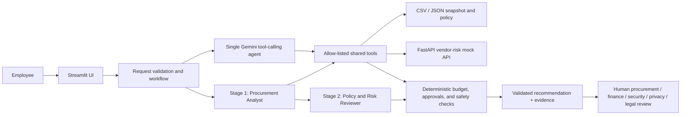

# AI Procurement Request Copilot

An internal, evidence-led assistant for assessing the supplied synthetic software purchase requests. It gathers budget, catalog, vendor/security and policy evidence, applies deterministic rules, and recommends a next action for an authorized human. It never approves or purchases software. The assignment PDF remains the source of truth for scope and human authority.

## Workflow and architecture



The single architecture makes real Gemini API chat-completion calls with function calling and structured JSON output. It uses Google's OpenAI-compatible endpoint through the existing Python SDK. The staged architecture uses two distinct model stages: the analyst gathers shared evidence with tools and produces an evidence package; a second model call independently reviews that package alongside deterministic results. Tool calls and LLM calls are bounded and counted. Both workflows use the same tools and code-enforced policy checks. Model statements are labeled as interpretations, and only tool-returned references can substantiate them.

`app.py` owns the Streamlit UI. `src/solution.py` validates inputs, runs either architecture and merges model suggestions conservatively into deterministic results. `src/agents.py` contains the bounded Gemini tool loop and schemas. `src/tools.py` contains the four independently callable tools. `src/data_access.py` reads the supplied snapshot. `mock_api/app.py` is the supplied FastAPI vendor-risk service. `evals/` contains the same nine cases for both architectures, the runner, and results.

## Data, policy and limits

All starter-pack records are synthetic. CSV identifiers and budget arithmetic are validated. The fixed policy snapshot is 2026-09-30; review freshness is computed relative to that snapshot. The budget tool uses the supplied available amount (annual budget less committed spend) and deterministic thresholds: up to $1,000 Manager; $1,000.01–$10,000 Department Head and Procurement; $10,000.01–$25,000 Department Head, Finance and Procurement; above $25,000 Department Head, Finance, CFO and Procurement. Policy, security, privacy, legal, overlap and human-review rules remain code-enforced.

Catalog matches are possible overlaps, not confirmed equivalents. Vendor service outage, expired status and conflicting records remain visible and trigger human review. The model cannot override deterministic checks, record approval or infer that missing evidence means safe. The system does not retain decisions durably, capture reviewer decisions, or connect to a real approval system. Catalog search is a small transparent heuristic and the data is synthetic.

## Tools

| Tool | Inputs | Contract and failure behavior |
|---|---|---|
| Budget and approvals | Verified department and submitted annual cost | Budget availability, sufficiency, threshold and minimum approvers; missing department/budget remains missing |
| Existing software | Validated request fields | Possible catalog matches and approved purchase history with source references |
| Vendor/security | Exact submitted vendor name | Internal registry plus `GET /vendor-risk/{vendor_name}`; outage/404 is unverified, never safe |
| Policy lookup | None | Policy text, source path and fixed snapshot reference |

The LLM can call only these named tools. Pydantic validates tool arguments and request facts are pinned to the submitted requester, vendor and cost. The model cannot run SQL, shell commands, arbitrary HTTP calls or executable code.

## Setup and configuration

Python 3.11+ is recommended. From this project directory:

```powershell
python -m venv .venv
.\.venv\Scripts\Activate.ps1
python -m pip install -r requirements.txt
```

Use the project-root `.env` as the private configuration file. Create a Gemini API key in [Google AI Studio](https://aistudio.google.com/app/apikey) and set `GEMINI_API_KEY` locally; do not paste it in chat, source code, the UI, fixtures, or a public repository. `.env` is ignored by Git. If starting from a fresh checkout, copy `.env.example` to `.env`. The app loads `.env` from the project root regardless of the current working directory; operating-system environment variables take precedence. `GEMINI_API_KEY` and `GEMINI_MODEL` configure the provider; `GEMINI_TIMEOUT_SECONDS` controls request timeout.

Configuration:

```text
GEMINI_API_KEY=your-key-here
GEMINI_MODEL=gemini-3.1-flash-lite
GEMINI_TIMEOUT_SECONDS=45
GEMINI_REQUEST_PACING_SECONDS=1
GEMINI_RATE_LIMIT_RETRIES=2
GEMINI_RETRY_AFTER_CAP_SECONDS=30
VENDOR_RISK_BASE_URL=http://127.0.0.1:8001
```

`gemini-3.1-flash-lite` is the default model; Google currently lists it with function-calling and structured-output support. The Gemini API has a free tier for supported models, subject to account access and rate limits. Google says free-tier content may be used to improve its products, so use only the supplied synthetic assignment data and check current terms/quotas before sending other information. The project calls Google's documented OpenAI-compatible endpoint. The `openai` Python SDK is used only as an HTTP/API compatibility client for that Gemini endpoint; it does not configure an OpenAI provider or model, and there is no OpenAI fallback. The Gemini key is read server-side by Python and is never sent to Streamlit/browser code.

## Run the application

From the project directory, the one-command launcher starts the mock vendor API and Streamlit:

```powershell
python run_local.py
```

Open `http://127.0.0.1:8501`. In the sidebar, choose the single-agent or staged two-agent workflow and execution mode. With a key configured, real LLM mode is the default; choose deterministic demo explicitly to use the offline path. Without a key, the UI clearly selects and labels deterministic demo mode and explains how to enable real mode. A real-mode API/configuration error is shown without falling back to demo.

Always use `python run_local.py` for the full application: it starts the mock vendor-risk API, waits for `/health`, and then starts Streamlit. Starting Streamlit by itself does not start the mock API; vendor lookups will be treated as unavailable and require human review. If vendor evidence is unavailable, check `http://127.0.0.1:8001/health` and restart the launcher. A local vendor record such as SignFlow should respond quickly when that service is running.

The interface reports active architecture, mode and model, loading state, tool activity, evidence, recommendation, approvals, missing facts, risks and required human handoff. A recommendation is not an authorization. Reviewer decisions are not recorded by this application.

## Tests and evaluation

Offline regression tests use mocked SDK responses and do not spend API credits:

```powershell
python verify_setup.py
python -m unittest discover -s tests -v
```

Run the six supplied public cases for either architecture:

```powershell
python evals/run_public_evals.py --architecture single --mode demo
python evals/run_public_evals.py --architecture staged --mode demo
```

Run the nine-case paired deterministic comparison:

```powershell
python evals/run_comparison.py --mode demo
```

Run a live comparison with the configured key (both architectures use the same nine cases):

```powershell
python evals/run_comparison.py --mode real
```

Start with one shared case for each architecture before the full evaluation:

```powershell
python evals/run_comparison.py --mode real --limit 1 --timeout-seconds 25 --rate-limit-retries 0 --request-pacing-seconds 0
```

This diagnostic makes two serial architecture runs on EVAL-01, uses a shorter per-request timeout, and disables 429 retries/pacing for a quick first check. After it completes successfully, run the full suite with `python evals/run_comparison.py --mode real`. Real evaluations default to `real` mode and never switch to demo. The runner processes cases serially, checkpoints each outcome, and distinguishes passes, assertion failures, rate limits, timeouts, authentication failures, malformed model responses, tool-loop termination, interruption and other errors. API/infrastructure errors are excluded from model-quality accuracy denominators and counted separately. HTTP 429 retries are bounded by `GEMINI_RATE_LIMIT_RETRIES` (default 2) and use `Retry-After`/`Retry-After-Ms` when present, capped by `GEMINI_RETRY_AFTER_CAP_SECONDS` (default 30 seconds). `GEMINI_REQUEST_PACING_SECONDS` (default 1) spaces request starts. CLI options can override these settings for a run.

`--mode real` exits with an actionable error if no API key is configured. It never falls back to demo and is the evaluation runner's default. `--mode auto` is an explicit opt-in; without a key it prints that it selected the labelled deterministic demo path. Live failures are recorded per case, and earlier case results are preserved. Real results record timestamp, model, mode, calls, latency, outcomes, evidence references and classified errors. Deterministic assertions separately check expected recommendations, approvals, risk flags and human review.

Demo artifacts are `evals/results_demo.json`, `.csv` and `_summary.md`; the legacy `results.*` files mirror the most recent demo run and include a mode label. Live artifacts use the `results_real.*` names. Demo metrics are offline code-path checks, not model-quality or live-LLM performance. A one-case live diagnostic completed for both architectures: both returned model outputs with four tool calls and no API error, but both failed the EVAL-01 expected-recommendation assertion. The single path took 5.36 seconds with 2 LLM calls; staged took 8.63 seconds with 3. These are one-case diagnostic results, not a full comparison or an architecture-quality conclusion. See the per-case real artifacts; the full nine-case live comparison remains unrun.

## Current deterministic evaluation

The paired demo comparison completed 9/9 expected outcomes for each architecture, with deterministic policy assertions, traceable evidence and human review retained in all cases. EVAL-07 uses an explicitly synthetic tool-result injection fixture documented under `evals/fixtures/`; it is not a company record. In the latest run, mean local latency was 11.32 ms single and 10.04 ms staged; each used 4 tools on average and 0 LLM calls. These small offline timings are machine/service dependent and do not compare model quality or establish a staged-path advantage. The six supplied public cases passed 6/6 for each architecture. See `evals/results_demo_summary.md` and the per-case JSON/CSV.

## Architecture decision

See [the decision memo](docs/architecture_decision.md), which treats the demo comparison as a deterministic baseline only. The live architecture choice is inconclusive until both real workflows are evaluated on the same cases with a configured provider. The memo is under the assignment's 500-word limit.

## Repository map

- `src/contracts.py` — decision and telemetry schema
- `src/llm_config.py` — project-root environment configuration
- `src/agents.py` — real Gemini agent stages, validated function calling, and structured output
- `src/solution.py` — deterministic controls, demo mode and architecture orchestration
- `src/tools.py` — four shared tools
- `data/` — synthetic records and actual supplied policy
- `mock_api/` — FastAPI mock vendor/security service
- `evals/` — cases, both runners and mode-separated artifacts
- `docs/architecture.md` — component and sequence diagram
- `docs/assumptions.md` — assumptions and unresolved limits
- `docs/architecture_decision.md` — ship decision memo

No actual credentials are included. `.env`, caches, environments and bytecode are excluded by `.gitignore`.
